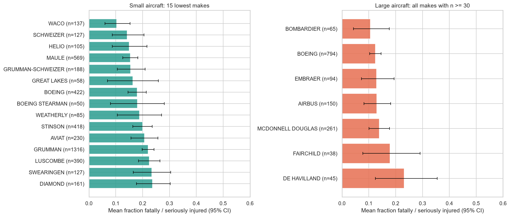
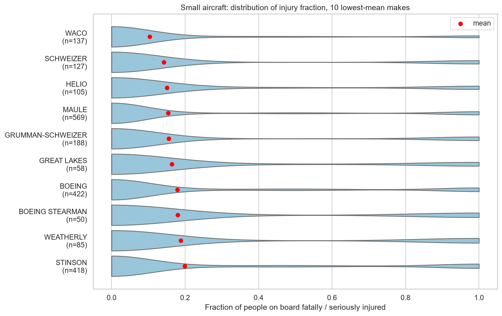
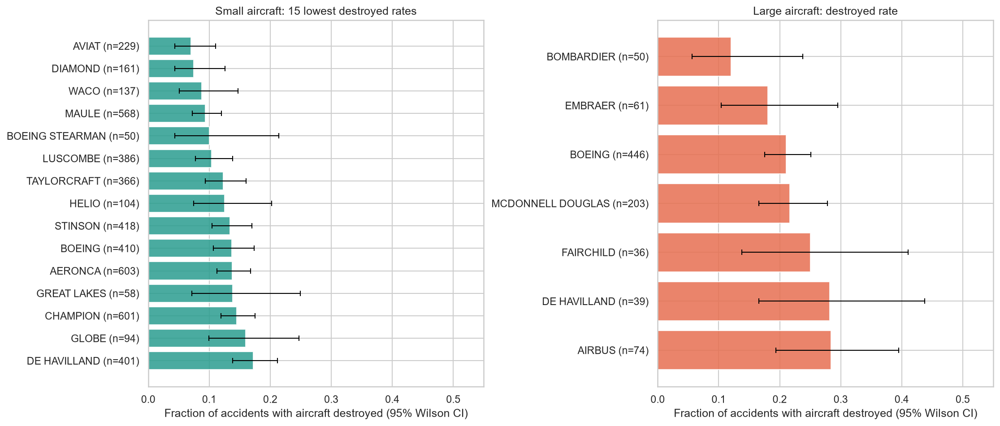
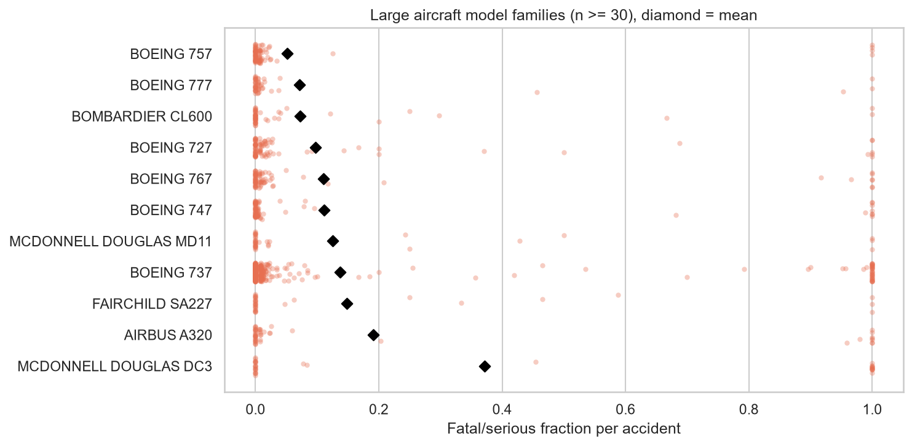
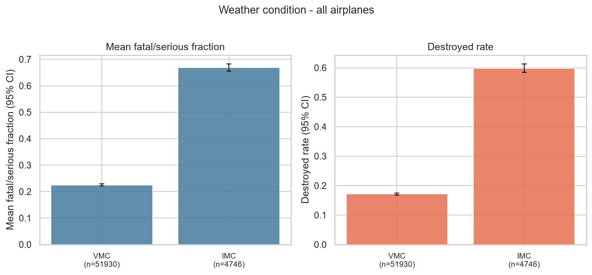
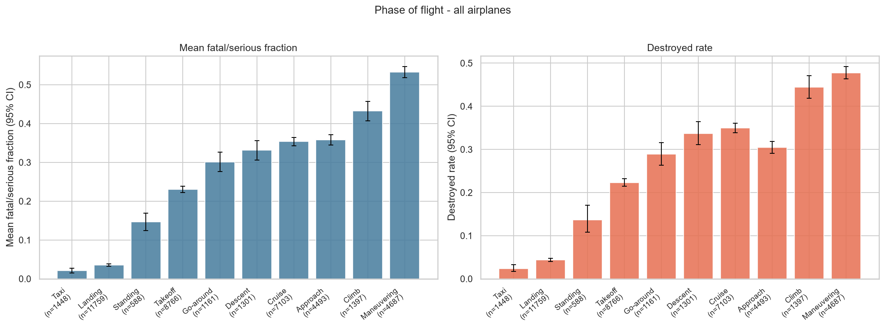

# Aviation Accident Analysis

**Client:** airline / aircraft insurer  **Data:** NTSB aviation accidents, 1948-2022 (88,889 records; analysis uses 1983 onward)

**Question:** which airplane makes and models show low rates of total destruction and low likelihood of fatal/serious injuries *in the event of an accident*, separately for small (<20 people) and large aircraft, and which general conditions drive severity?

## Repository contents
| File | Purpose |
|---|---|
| `Aviation_Accidents_Cleaning.ipynb` | Load, inspect, clean, filter, derive metrics, save `data/AviationData_clean.csv` |
| `Aviation_Accidents_Data_Analysis.ipynb` | EDA, make/model recommendations, factor analysis, discussion |
| `data/AviationData_clean.csv` | Cleaned data (59,150 events) used by the analysis notebook |
| `images/` | Figures used in this README and the notebooks |

To reproduce: download the Kaggle CSV (`AviationData.csv`) into `data/`, run the cleaning notebook, then the analysis notebook.

## Data preparation (summary)
- **Filters:** events from 1983 on (40-year maximum service life); *Accident* investigations only; professional builds only (`Amateur.Built == "No"`); **airplanes only**.
- **Aircraft category imputation:** the category is blank for ~64% of records (almost all pre-2008). It was imputed from the Make+Model mode, then the Make mode (>=95% pure), then engine type; unresolved rows were dropped.
- **Injury metric:** `Total.Aboard` = fatal + serious + minor + uninjured; `Fatal.Serious.Frac` = (fatal + serious) / total aboard.
- **Destruction metric:** `Destroyed` = 1 if damage is "Destroyed", 0 if substantial/minor, missing if unknown (not imputed).
- **Make/Model:** upper-casing, punctuation and corporate-suffix removal, alias merging (e.g. `BEECHCRAFT` to `BEECH`, `ROBINSON HELICOPTER` to `ROBINSON`); makes with <50 events removed; `Plane.Type = Make + Model` is the unique type identifier.
- **Other columns:** placeholders (`UNK`, `Unknown`) set to NaN, duplicate categories merged, impossible values (0 engines) set to NaN, rare categories grouped, columns with <=20,000 non-nulls dropped.
- **Small vs large:** a plane *type* is "large" if the 90th percentile of people aboard across its accidents is >= 20 (a per-event cut-off would mislabel airliners on cargo flights and small planes in collisions with airliners).
- **Robustness:** minimum 30 events per group for comparisons (10 for plane types), 95% confidence intervals (bootstrap for n < 200), Mann-Whitney / Kruskal-Wallis and chi-square tests with Holm correction where multiple makes are tested.

> The data contains only aircraft that had an accident and no flight-hours, so all results are **severity given an accident**, not accident rates.

## Key findings

Baselines: small aircraft average a **0.279** fatal/serious fraction and **21.6%** destroyed; large aircraft **0.135** and **21.8%**.

### Small aircraft

- **Maule** is the most robust recommendation (n=569; injury fraction 0.154 vs 0.281 for the rest of the fleet; destroyed 9.3% vs 21.7%; significant after Holm correction).
- **Waco, Helio, Schweizer/Grumman-Schweizer** have the lowest occupant-injury fractions; **Aviat (7.0%) and Diamond (7.5%)** have the lowest destruction rates. These are niche/vintage designs, so usage differs from the mainstream fleet.
- Cessna (0.245; 19.1% destroyed) outperforms Piper (0.302; 23.1%); Cirrus, Mitsubishi, Socata, Beech, Mooney and Aero Commander are on the higher-risk side.
- Best individual types: Maule MX-7-235, M-4, M-4-220C, Stinson 108-1, Helio H-295/H-391B.

### Large aircraft

- Seven makes pass the sample filter: Bombardier 0.106, Boeing 0.125, Embraer 0.129, Airbus 0.130, McDonnell Douglas 0.139, Fairchild 0.179, De Havilland 0.232.
- **They are not statistically distinguishable** (Kruskal-Wallis p = 0.32; destruction chi-square p = 0.37). Boeing, Airbus, Embraer, Bombardier and McDonnell Douglas form one comparable low-risk tier; Boeing has the strongest evidence (n=794). On destruction alone Airbus looks worst (28%, n=74) and Bombardier best (12%, n=50), but the confidence intervals overlap widely.
- Preferred types: **Boeing 757 family (0.051; 10.3% destroyed; n=89), 717-200, 777, Bombardier CL-600, MD-80/MD-88, A320-232**. Less favourable: Boeing 737-200 / 737-400, Airbus A320 (unspecified variant), DC-3, DHC-6-300, Beech 1900.

### Factors affecting severity

- **Weather:** IMC accidents have a 0.669 fatal/serious fraction and 59.8% destroyed vs 0.225 and 17.2% in VMC (~3x and ~3.5x). Holds for both small and large aircraft.
- **Phase of flight:** landing/taxi accidents are nearly harmless (<5% destroyed); manoeuvring (0.533 injury, 47.8% destroyed), climb and cruise are the worst.

- **Engines:** twin-engine small aircraft fare worse than singles (0.388 vs 0.262), but this is confounded by IMC exposure and business use; in large aircraft engine count makes no difference. Turboprop/turbojet small aircraft fare worse than piston.
- **Purpose:** instructional flying is safest (0.156; 11.3% destroyed); business flying is the most damaging high-volume purpose (31.6% destroyed).

## Limitations
No exposure data; US-centric NTSB records; persons aboard includes crew; pre-2008 aircraft categories are imputed; per-type samples are small (10-30) so type rankings are indicative; associations are not causal.
